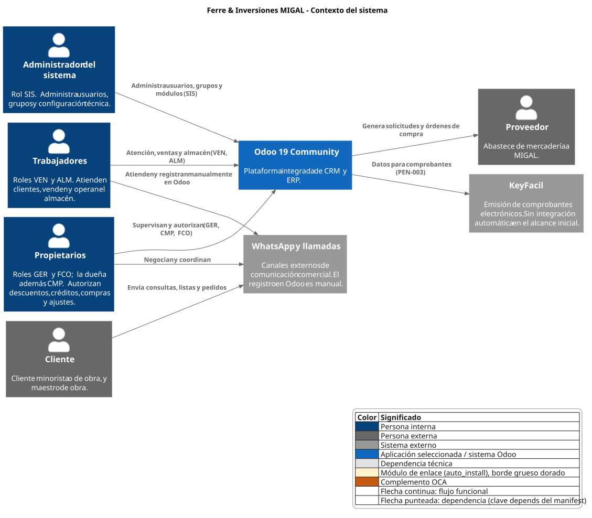
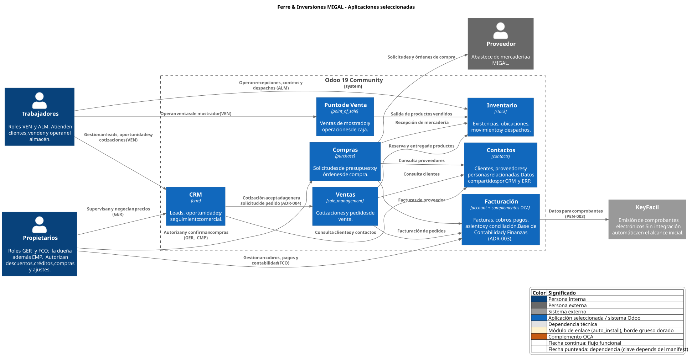
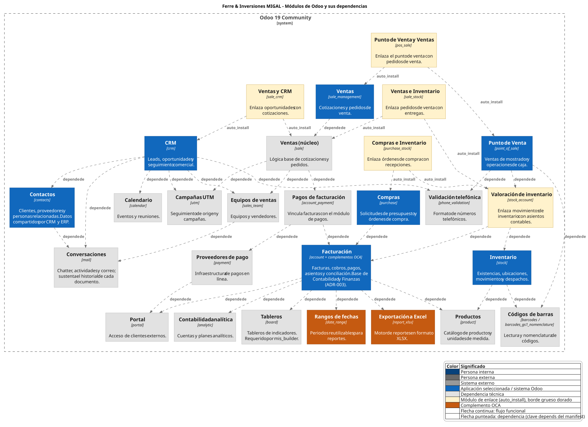
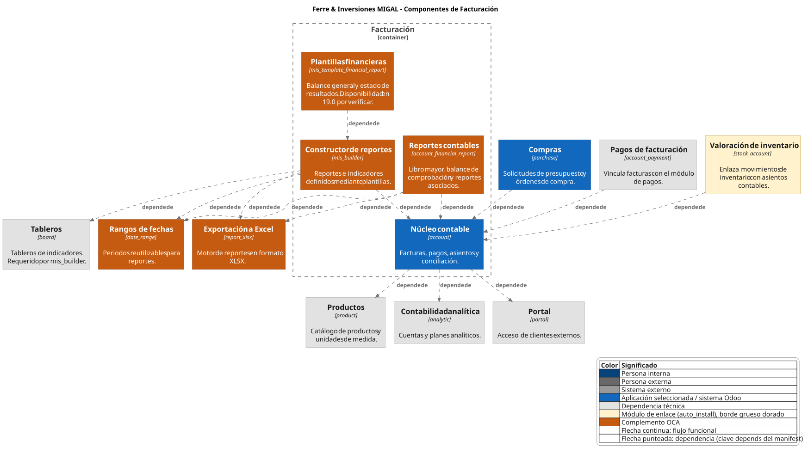

# Vistas de arquitectura

Este documento consolida las vistas de la arquitectura del sistema de información de **Ferre & Inversiones MIGAL**, basado en Odoo Community. Explica qué muestra cada diagrama, cómo se relacionan entre sí y cómo se mantienen.

Las vistas representan la versión vigente de la arquitectura ([VER-02](../versiones/VER-02-crm-erp.md)). Constituyen un diseño propuesto y no acreditan que las aplicaciones o integraciones representadas estén implementadas en Odoo.

## 1. Modelo de representación

Las vistas siguen el modelo C4, que describe un sistema en niveles sucesivos de detalle.

| Nivel | Vista | Qué representa en este proyecto |
|---|---|---|
| 1. Contexto | Sistema y su entorno | Odoo como una única caja, junto con las personas y sistemas externos con los que interactúa. |
| 2. Contenedores | Aplicaciones y módulos | Cada aplicación o módulo de Odoo, identificado por su nombre técnico. |
| 3. Componentes | Estructura interna de un contenedor | Las partes que conforman una aplicación. Se utiliza únicamente para Facturación. |

El nivel de código no se utiliza.

### Términos empleados

| Término | Significado |
|---|---|
| **Contenedor** | Aplicación o módulo de Odoo. Por ejemplo, CRM (`crm`) o Conversaciones (`mail`). |
| **Componente** | Parte interna de un contenedor. Por ejemplo, el núcleo contable y los complementos que conforman Facturación. |
| **Relación** | Flecha entre dos elementos. Puede representar un flujo funcional o una dependencia técnica. |
| **Dependencia** | Tipo de relación, no un elemento. Indica que un módulo requiere a otro para funcionar y se origina en la clave `depends` de su manifiesto. |
| **Módulo de enlace** | Módulo que se instala automáticamente (`auto_install`) cuando coinciden sus dos dependencias y conecta ambas aplicaciones. |

## 2. Convenciones visuales

Todas las vistas incluyen una leyenda con los siguientes significados.

| Representación | Significado |
|---|---|
| Azul oscuro | Persona interna de MIGAL. |
| Gris oscuro | Persona externa. |
| Gris medio | Sistema o canal externo. |
| Azul | Aplicación seleccionada por el proyecto, o el sistema Odoo. |
| Gris claro | Dependencia técnica: módulo instalado porque otro lo requiere. |
| Amarillo con borde grueso | Módulo de enlace (`auto_install`). |
| Naranja | Complemento de la Odoo Community Association (OCA). |
| Flecha continua | Flujo funcional. |
| Flecha punteada | Dependencia (`depends`) o instalación automática (`auto_install`). |

Una flecha punteada de A hacia B se lee "A depende de B". Mientras A permanezca instalado, B no puede desinstalarse.

## 3. Vistas

### 3.1. Contexto del sistema



**Fuente:** [c4-contexto.puml](fuentes/c4-contexto.puml)

Muestra Odoo dentro de su entorno:

- **Propietarios, trabajadores y administrador del sistema** utilizan Odoo según sus roles (GER, FCO, CMP, VEN, ALM y SIS).
- **Clientes** se comunican con MIGAL mediante WhatsApp y llamadas. Los trabajadores registran manualmente la información relevante en Odoo.
- **KeyFacil** recibe los datos para emitir comprobantes. La forma de intercambio está pendiente de definición ([PEN-003](../../producto/registro-pendientes.md)).
- **Proveedores** reciben las solicitudes y órdenes de compra que genera Odoo.

### 3.2. Aplicaciones seleccionadas



**Fuente:** [c4-contenedores.puml](fuentes/c4-contenedores.puml)

Muestra las siete aplicaciones elegidas por el proyecto y los flujos entre ellas:

- **CRM hacia Ventas:** la cotización aceptada genera una solicitud de pedido, frontera definida en [INT-01](../integraciones/INT-01-CRM-ERP.md).
- **Ventas, Punto de Venta y Compras hacia Inventario:** reserva y entrega, salida de mostrador y recepción de mercadería.
- **Ventas y Compras hacia Facturación:** facturación de pedidos y facturas de proveedor.
- **CRM, Ventas y Compras hacia Contactos:** consulta de los clientes y proveedores compartidos.
- **Facturación hacia KeyFacil:** datos para comprobantes.

Los flujos son ilustrativos. Los procesos vigentes se documentan en la carpeta `procesos/`.

### 3.3. Módulos de Odoo y sus dependencias



**Fuente:** [c4-modulos-dependencias.puml](fuentes/c4-modulos-dependencias.puml)

Muestra todas las aplicaciones y los módulos adicionales que Odoo instala para su funcionamiento. Cuatro grupos de elementos permiten leerla:

| Grupo | Ejemplos |
|---|---|
| Aplicaciones seleccionadas | CRM, Ventas, Punto de Venta, Inventario, Compras, Facturación y Contactos. |
| Dependencias técnicas | Conversaciones, Calendario, Equipos de ventas, Portal, Tableros y Productos. |
| Módulos de enlace | Ventas y CRM, Ventas e Inventario, Compras e Inventario, Punto de Venta y Ventas, y Valoración de inventario. |
| Complementos y bibliotecas OCA | Rangos de fechas y Exportación a Excel. |

Principales lecturas:

- **Facturación es un núcleo obligatorio.** Ventas, Compras y Punto de Venta la requieren, de forma directa o mediante otros módulos.
- **Punto de Venta requiere Inventario y Facturación** mediante Valoración de inventario.
- **Conversaciones sustenta el historial** de los documentos y la requieren CRM, Contactos y Equipos de ventas.
- **Los módulos de enlace conectan aplicaciones** como Ventas con Inventario, o CRM con Ventas, y añaden comportamiento que debe contrastarse con las fronteras definidas.
- **Se omiten por su baja relevancia** el módulo de resúmenes periódicos y los módulos de apoyo menores, como se indica en el archivo fuente.

### 3.4. Componentes de Facturación



**Fuente:** [c4-componentes-facturacion.puml](fuentes/c4-componentes-facturacion.puml)

Detalla la estructura interna de Facturación:

- **Núcleo contable (`account`):** facturas, pagos, asientos y conciliación. Lo requieren Compras, Pagos de facturación y Valoración de inventario.
- **Complementos OCA:** reportes contables (`account_financial_report`), constructor de reportes (`mis_builder`) y plantillas financieras (`mis_template_financial_report`).
- **Bibliotecas de apoyo:** rangos de fechas, exportación a Excel y tableros, requeridas por los complementos.

La disponibilidad de las plantillas financieras para la versión de Odoo utilizada está por verificar ([RSK-001](../riesgos-y-controles.md)).

## 4. Relación entre las vistas

Las vistas avanzan de lo general a lo específico:

1. El **contexto** identifica quién interactúa con Odoo.
2. Las **aplicaciones seleccionadas** muestran qué funciones ofrece Odoo y cómo se relacionan.
3. Los **módulos y dependencias** revelan qué requiere cada aplicación para funcionar.
4. Los **componentes de Facturación** detallan la aplicación con más dependencias y complementos externos.

Los elementos se definen una sola vez en el archivo común de definiciones, por lo que su nombre, tecnología y descripción son iguales en todas las vistas.

## 5. Organización de archivos y mantenimiento

```
arquitectura/vistas/
├── fuentes/
│   ├── c4-modelo-comun.iuml
│   ├── c4-contexto.puml
│   ├── c4-contenedores.puml
│   ├── c4-modulos-dependencias.puml
│   └── c4-componentes-facturacion.puml
└── render/
    ├── c4-contexto.svg
    ├── c4-contenedores.svg
    ├── c4-modulos-dependencias.svg
    └── c4-componentes-facturacion.svg
```

- `c4-modelo-comun.iuml` es un archivo de inclusión: define estilos, elementos y leyenda. No es un diagrama y no tiene render.
- Cada archivo `.puml` tiene un render `.svg` con el mismo nombre en `render/`. La estructura de carpetas de `render/` replica la de `fuentes/`.
- Cuando una misma categoría reúna varios diagramas de componentes, agruparlos en una subcarpeta `componentes/`, tanto en `fuentes/` como en `render/`.
- Todo cambio en una fuente se versiona junto con su render, y viceversa, como control del riesgo [RSK-008](../riesgos-y-controles.md).

### Regeneración de los renders

Desde la carpeta `fuentes/`, ejecutar PlantUML con la salida dirigida a `../render`:

```
java -jar plantuml.jar -tsvg -charset UTF-8 -o ../render c4-contexto.puml c4-contenedores.puml c4-modulos-dependencias.puml c4-componentes-facturacion.puml
```

Los renders versionados se generaron con el motor de diseño interno de PlantUML (`-Playout=smetana`), por no disponer de Graphviz. Con Graphviz instalado, la disposición de los elementos puede diferir sin alterar su contenido.

### Modificación del modelo

- Para cambiar un elemento, editar su procedimiento en `c4-modelo-comun.iuml`.
- Para cambiar la versión de Odoo mostrada, editar la variable `$odoo_etiqueta` del mismo archivo.
- Las relaciones se declaran en cada vista, porque dependen del nivel de detalle.

## 6. Limitaciones

- Las vistas son un diseño propuesto y no demuestran una implementación operativa.
- Los flujos funcionales de la vista de aplicaciones son ilustrativos.
- Las dependencias se obtuvieron de los manifiestos publicados de Odoo y de la OCA, y no de una instancia instalada ([RSK-007](../riesgos-y-controles.md)).
