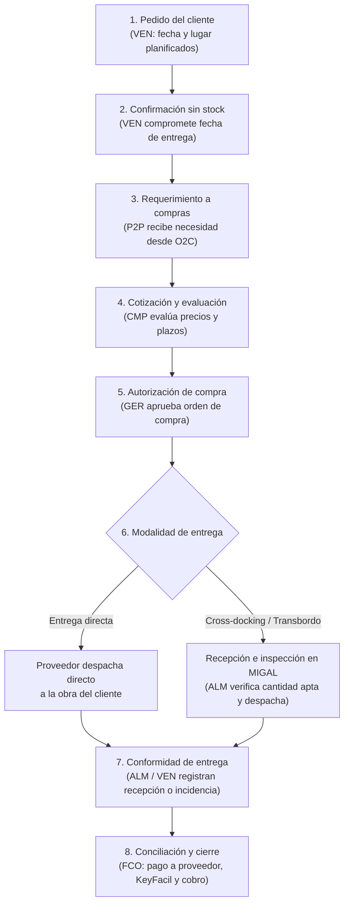

# Cadena de suministro sin stock — Ferretería MIGAL

**Estado del documento:** modelo operativo de abastecimiento bajo pedido para materiales de construcción de alto volumen, construido a partir de los flujos propuestos de compras (P2P), ventas (O2C) e inventario, sobre **Odoo 19 Community** y **KeyFacil**.

---

## 1. Propósito y alcance del modelo sin stock

Ferretería MIGAL es una empresa comercializadora sin producción propia. Para **cuatro familias específicas de alto volumen: cemento, agregado, fierro y ladrillo**, la empresa opera bajo un modelo de **venta sin stock** (abastecimiento bajo pedido, con entrega directa del proveedor en obra o transbordo rápido en almacén).

Estos cuatro materiales ocupan demasiado espacio físico en tienda y almacenes, y su abastecimiento no es continuo. Por esa razón, MIGAL no mantiene inventario permanente de estas familias; sin embargo, el equipo comercial confirma la venta y compromete una fecha de entrega planificada antes de contar con la mercadería física.

Este modelo conecta directamente los tres procesos centrales de MIGAL:

- **O2C (Venta y cobro):** captura el pedido del cliente con fecha y lugar de entrega pactados, dispara la necesidad de compra, coordina la entrega final y gestiona el comprobante en **KeyFacil** y el cobro.
- **P2P (Compra y pago):** convierte la venta comprometida en un requerimiento de compra, cotiza y negocia con proveedores para cumplir la fecha ofrecida, formaliza la orden de compra y concilia el pago al proveedor.
- **Inventario (Control físico):** no almacena stock permanente de estas cuatro familias, pero controla la recepción física, la inspección de cantidad apta y daños, y el transbordo o despacho cuando la mercadería pasa por las instalaciones de MIGAL.

> **Nota sobre datos reales vs. pendientes:** La operación sin stock para las cuatro familias, el uso de **Odoo 19 Community**, la emisión fiscal en **KeyFacil** y la lista de activos de carga y transporte son **datos reales observados**.   Las cifras históricas, tiempos de entrega de proveedores e indicadores de cumplimiento se declaran explícitamente como **pendientes**.

---

## 2. Flujo de abastecimiento de extremo a extremo

### Diagrama del flujo

### Secuencia operativa paso a paso

| Etapa | Qué ocurre en la práctica | Rol principal | Salida |
|---|---|---|---|
| **1. Solicitud del cliente** | El cliente solicita material de una de las 4 familias indicando cantidad, lugar de entrega y fecha requerida (ej. 2,000 ladrillos para la próxima semana). | `VEN` | Pedido cotizado con fecha y destino definidos. |
| **2. Confirmación sin stock** | Aunque no exista stock físico en tienda ni almacén, `VEN` confirma la venta y compromete la fecha de entrega con el cliente. | `VEN` | Orden de venta confirmada con abastecimiento pendiente. |
| **3. Requerimiento de compra** | La venta comprometida genera de inmediato una necesidad de abastecimiento hacia el flujo de compras, indicando producto, unidad, cantidad y fecha límite. | `VEN` / `CMP` | Requerimiento de compra vinculado a la venta. |
| **4. Cotización y evaluación** | `CMP` solicita cotizaciones a proveedores, verifica disponibilidad, precio, condiciones de pago y plazo de entrega para cumplir la fecha pactada con el cliente. | `CMP` | Propuesta de compra trazable y comparativa de plazos. |
| **5. Autorización de compra** | `GER` revisa las condiciones negociadas y autoriza formalmente la orden de compra que compromete a MIGAL frente al proveedor. | `GER` | Orden de compra autorizada y enviada al proveedor. |
| **6. Seguimiento y coordinación** | `CMP` confirma la aceptación del proveedor y coordina si el despacho será directo a la obra del cliente o mediante transbordo en MIGAL. Si hay cambios o incumplimientos, `GER` interviene. | `CMP` (excepciones: `GER`) | Confirmación de despacho o alerta temprana de desvío. |
| **7. Recepción / Transbordo / Despacho** | Si pasa por MIGAL, `ALM` cuenta, inspecciona daños, separa material apto y carga la unidad propia para despacho. Si va directo a obra, se verifica la llegada y descarga en destino. | `ALM` | Recepción validada y constancia de despacho o entrega. |
| **8. Comprobantes, pago y cobro** | `FCO` concilia la orden autorizada, la recepción real y el comprobante del proveedor para ejecutar el pago. En paralelo, gestiona el comprobante fiscal en **KeyFacil** y concilia el cobro al cliente. | `FCO` | Obligación pagada, comprobante en KeyFacil emitido y cobro conciliado. |

---

## 3. Actores y matriz RACI

Los roles operativos definidos para este flujo son exclusivamente `GER`, `VEN`, `ALM`, `CMP`, `FCO` y `SIS`. *(Leyenda: **R** = Responsable de ejecutar, **A** = Aprobador / Dueño final, **C** = Consultado, **I** = Informado).*

| Actividad clave del flujo | `GER` | `VEN` | `ALM` | `CMP` | `FCO` | `SIS` |
|---|---|---|---|---|---|---|
| Capturar pedido del cliente y comprometer fecha de entrega | I | **A / R** | C | C | I | — |
| Generar requerimiento de compra desde la venta confirmada | I | **R** | I | **A** | — | — |
| Solicitar cotizaciones y evaluar plazos/condiciones de proveedores | I | C | — | **A / R** | C | — |
| Autorizar formalmente la orden de compra y gestionar excepciones | **A / R** | I | — | R | I | — |
| Verificar recepción física, cantidad apta, daños y transbordo | I | I | **A / R** | C | I | — |
| Coordinar y registrar el despacho y la entrega al cliente | I | C | **A / R** | I | I | — |
| Gestionar y conciliar comprobante y pago al proveedor | A | — | C | C | **R** | — |
| Gestionar comprobante en KeyFacil y conciliar cobro al cliente | A | C | I | — | **R** | — |
| Configurar permisos, roles y parámetros en Odoo 19 Community | A | I | I | I | I | **R** |

> **Nota de autorización:** Aun cuando en la operación diaria una misma persona pueda asumir más de un rol, la separación funcional entre quien vende (`VEN`), quien compra (`CMP`), quien autoriza (`GER`), quien verifica físicamente (`ALM`) y quien concilia dinero y documentos (`FCO`) debe mantenerse trazable en el sistema. `SIS` da soporte técnico y de permisos sin sustituir decisiones comerciales, operativas ni financieras.

---

## 4. Cinco variables de gestión de cadena de suministro

Para monitorear el desempeño del modelo sin stock, se definen cinco variables clave diferenciando estrictamente los **criterios reales observados** de los **valores pendientes de medición**:

| Variable | Unidad de medida y periodo | Criterio de cálculo / Rango | Estado de datos (Real vs. Pendiente) |
|---|---|---|---|
| **1. Demanda** | Unidades físicas por familia (bolsas de cemento, m³ de agregado, varillas/kg de fierro, millares/unidades de ladrillo). **Periodo:** Semanal / Mensual. | Suma de cantidades solicitadas en órdenes de venta confirmadas para las 4 familias en el periodo: `Demanda = Σ Cantidad pedida por cliente` | **Pendiente:** No se cuenta aún con serie histórica consolidada de demanda semanal o mensual por familia. |
| **2. Inventarios** | Unidades físicas y kg en almacén / tienda. **Periodo:** Diario (por operación). | **Stock objetivo = 0**. **Stock de seguridad = 0**. Por política sin stock, solo existe inventario transitorio mientras la carga pasa por transbordo (cross-docking) antes de salir a obra. | **Real observado:** Política declarada de **stock = 0** y **stock de seguridad = 0** para las 4 familias por restricción de espacio y suministro discontinuo. |
| **3. Capacidad** | Capacidad de carga útil (kg por viaje) y disponibilidad de equipos de manipuleo. **Periodo:** Por viaje / Diario. | Capacidad neta de transporte propio: - Camión de baranda: **2,500 kg útiles** (1 unidad). - Camión volquete: **3,580 kg útiles** (1 unidad). **Total flota propia:** **6,080 kg útiles simultáneos**, más equipos de carga y descarga. | **Real observado:** Capacidad nominal de unidades propias registrada. **Pendiente:** Tiempos reales de carga/descarga y horas efectivas disponibles por jornada. |
| **4. Disponibilidad** | Porcentaje de pedidos atendibles en la fecha solicitada o tiempo de respuesta del proveedor (lead time en días/horas). **Periodo:** Por pedido / Semanal. | Disponibilidad inmediata en tienda solo para bajas cantidades. La disponibilidad efectiva depende del **tiempo de respuesta del proveedor + tiempo de traslado/transbordo** frente al plazo prometido por `VEN`. | **Pendiente:** No existen tiempos de entrega (lead time) promedio medidos por proveedor ni tasa de confirmación oportuna. |
| **5. Nivel de servicio** | Porcentaje (%) de pedidos cumplidos. **Periodo:** Semanal / Mensual. | **OTIF (On-Time In-Full):** `(Pedidos entregados completos y en la fecha pactada / Total de pedidos comprometidos) × 100`. **Fill Rate:** `(Cantidad total entregada apta / Cantidad total solicitada) × 100`. | **Pendiente (Limitación actual):** No existe medición histórica de OTIF ni Fill Rate; la fecha comprometida se gestiona sin validación previa de stock ni de plazo confirmado del proveedor. |

---

## 5. Cuello de botella y relación con activos compartidos

### Principal cuello de botella identificado

El principal cuello de botella del flujo se produce en la **brecha entre el compromiso comercial inmediato (`VEN`) y la ventana de respuesta, despacho y transporte del proveedor (`CMP` / `ALM`)**:

1. **Compromiso sin validación previa:** `VEN` confirma la venta y promete una fecha de entrega antes de que `CMP` haya cotizado y confirmado la disponibilidad real del proveedor.
2. **Riesgo de descalce en plazo y cantidad:** Como el abastecimiento de estas cuatro familias no es continuo, cualquier demora del proveedor en confirmar stock, aprobar crédito/pago o despachar la mercadería comprime el margen de tiempo disponible para cumplir con el cliente.
3. **Saturación en transbordo y descarga:** Cuando la entrega no va directo del proveedor a la obra y requiere pasar por MIGAL, una llegada tardía o concentrada de varios pedidos genera congestión en la zona de recepción, descarga y reexpedición.

### Relación operativa con los activos compartidos de MIGAL

Aunque MIGAL no almacena stock permanente de cemento, agregado, fierro ni ladrillo, el flujo sin stock sí depende directamente de activos físicos y digitales compartidos con el resto de la ferretería:

| Tipo de activo | Activos reales de MIGAL | Uso y vínculo con el modelo sin stock |
|---|---|---|
| **Transporte propio** | - **Camión de baranda** (1 unidad × **2,500 kg útiles**) - **Camión volquete** (1 unidad × **3,580 kg útiles**) | Traslado de última milla desde almacén hacia obra cuando no hay entrega directa del proveedor. El camión volquete es clave para **agregados** a granel; el camión de baranda para **cemento, fierro y ladrillo**. Su límite de carga útil obliga a planificar múltiples viajes en pedidos grandes. |
| **Equipos de carga y manipuleo** | - **Montacargas de combustión** (1 unidad) - **Minicargador frontal con cuchara** (1 unidad) - **Tecle eléctrico** (1 unidad) - **Carretilla eléctrica** (1 unidad) | Operados en patio/almacén para transbordo rápido (cross-docking): el minicargador moviliza agregados; el montacargas, tecle y carretilla eléctrica agilizan la descarga y estiba de pallets de cemento, ladrillo y paquetes de fierro, reduciendo el tiempo de espera de los camiones. |
| **Espacios de tránsito** | Tienda y almacenes de MIGAL (zona de recepción y despacho) | No funcionan como depósito de largo plazo para estas 4 familias, sino como **punto temporal de transbordo e inspección** controlado por `ALM`. |
| **Sistemas de registro y supervisión** | - **Odoo 19 Community** (ventas, compras e inventario) - **KeyFacil** (emisión de comprobantes fiscales) | Soportan la trazabilidad entre la venta confirmada, la orden de compra autorizada, la recepción parcial o total y la conciliación contable/fiscal. `SIS` administra los accesos y permisos de cada rol. |
