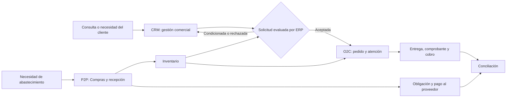

# Mapa de procesos de nivel 1 de ERP-MIGAL

**Estado:** clasificación funcional propuesta. Este mapa presenta los procesos y sus relaciones sin presuponer departamentos formales, procesos aprobados ni automatizaciones implementadas. Distingue el contexto documentado en [fuentes del negocio](../fuentes/fuentes-negocio.md) del diseño establecido en el [alcance](../arquitectura/alcance.md).

## 1. Procesos, entradas, salidas y responsabilidades

| Grupo | Proceso | Entrada → salida | Responsabilidades funcionales propuestas |
|---|---|---|---|
| Dirección | Prioridades y decisiones del negocio | Necesidades, resultados y excepciones → condiciones autorizadas | GER decide y supervisa. |
| Principal | Gestión comercial CRM, tramo inicial de O2C | Consulta o necesidad → oportunidad, cotización y aceptación o cierre comercial | VEN gestiona; GER autoriza excepciones de precio y crédito. |
| Principal | Order to Cash (O2C) | Cotización aceptada o venta inmediata → pedido atendido, entrega y cobro conciliados, o excepción documentada | VEN gestiona venta; ALM prepara y entrega; FCO registra comprobantes y cobros; GER autoriza excepciones. |
| Principal | Procure to Pay (P2P) | Necesidad de abastecimiento → compra autorizada, recepción comprobada y pago conciliado | CMP prepara y gestiona; GER confirma compras; ALM valida recepción; FCO gestiona obligaciones y pagos. |
| Apoyo transversal | Inventario y almacenes | Recepciones, salidas, traslados y conteos → existencias justificadas por ubicación | ALM opera; GER autoriza ajustes extraordinarios; VEN y CMP consultan según su función. |
| Apoyo | Información financiera y conciliación | Operaciones, comprobantes y pagos → saldos, referencias y revisión | FCO registra y concilia; GER supervisa. KeyFacil conserva la emisión externa según el alcance. |
| Apoyo | Datos, accesos y continuidad | Necesidades de información y acceso → registros controlados y servicio recuperable | SIS administra configuración y accesos con autorización de GER; cada rol responde por sus datos. |

Los códigos GER, VEN, ALM, CMP, FCO y SIS proceden del [modelo de autorización](../arquitectura/seguridad/modelo-autorizacion.md). Una persona puede reunir varios roles, pero preparar, autorizar y ejecutar una operación sensible siguen siendo responsabilidades distintas. La asignación efectiva de permisos está pendiente de comprobación.

## 2. Relaciones entre procesos

CRM es la entrada comercial de O2C, no una venta separada. [ADR-004](../arquitectura/decisiones/ADR-004-odoo-community-fronteras-crm-erp.md) y [INT-01](../arquitectura/integraciones/INT-01-CRM-ERP.md) establecen que aceptar una cotización no confirma una orden de venta. La respuesta a la solicitud puede ser aceptada, condicionada o rechazada; las dos últimas retornan al ámbito comercial. El mecanismo aún está propuesto y requiere validación en Odoo 19.

## 3. Eventos y controles compartidos

El [catálogo central de eventos](catalogo-eventos.md) asigna los códigos `EV` y distingue hechos actuales, propuestos y mixtos. Para la transición comercial son relevantes EV-006 (cotización aceptada), EV-009 (solicitud presentada), EV-014 (solicitud resuelta), EV-016 (condiciones renegociadas) y EV-018 (orden confirmada). Las correspondencias ambiguas entre la secuencia local de INT-01 y el catálogo permanecen abiertas: una solicitud condicionada no se equipara automáticamente a EV-014 ni se crea un código nuevo en este mapa.

Para P2P e inventario, el mapa remite a los eventos de necesidad de abastecimiento, pedido al proveedor, recepción y ajuste del catálogo. La compra registrada no aumenta por sí sola el stock; la recepción física y su validación son hechos distintos. Tampoco se confunden consulta de disponibilidad, reserva, confirmación, despacho y entrega conforme.

| Control transversal | Criterio de diseño y evidencia pendiente |
|---|---|
| Autorizaciones | GER aprueba descuentos especiales, compras, créditos y ajustes extraordinarios; verificar configuración y registro efectivo. |
| Datos compartidos | Mantener identidad de cliente, producto y unidad entre CRM, ventas, abastecimiento e inventario; definir reglas de calidad. |
| Entregas | Registrar cantidades, viajes, incidencias y conformidad sin dar por entregado un pedido solo por confirmarlo. |
| Comprobantes y pagos | Relacionar operaciones con comprobantes de KeyFacil y cobros o pagos; definir conciliación y excepciones, sin asumir integración automática. |
| Trazabilidad | Identificar quién solicita, evalúa, autoriza, ejecuta y modifica operaciones; comprobar registros y permisos. |

## 4. Documentación relacionada y límites

El [alcance](../arquitectura/alcance.md) delimita O2C, P2P y operaciones de apoyo. [INT-01](../arquitectura/integraciones/INT-01-CRM-ERP.md) detalla la frontera comercial; [módulos y dependencias](../arquitectura/modulos-y-dependencias.md) describe la plataforma elegida sin convertir módulos en procesos. Los flujos detallados de [CRM](comercial-crm/flujo-comercial.md), [O2C](o2c/flujo.md), [P2P](p2p/flujo.md) e [inventario](inventario/flujo.md) desarrollan cada proceso; sus reglas se registran en el [catálogo de reglas](catalogo-reglas.md) y sus eventos en el [catálogo de eventos](catalogo-eventos.md). [Supuestos y vacíos](../fuentes/supuestos-y-vacios.md) registra las preguntas que impiden cerrar controles o políticas.

No se atribuyen a MIGAL departamentos comerciales, logísticos o informáticos separados. Tampoco se presupone comercio electrónico, automatización de WhatsApp, integración automática con KeyFacil, gestión de flota o contabilidad tributaria integral fuera del [alcance inicial](../arquitectura/alcance.md).

## 5. Validaciones pendientes

- Revisar con propietarios el inicio, fin y responsables reales de cada proceso, así como las excepciones de ventas, compras, recepción y entrega.
- Confirmar políticas de precios, crédito, abastecimiento y promesas de entrega antes de convertirlas en reglas.
- Validar las correspondencias ambiguas de eventos sin alterar el catálogo canónico.
- Comprobar en Odoo 19 la trazabilidad, los permisos y las transiciones propuestas; las relaciones del mapa no son resultados de pruebas.
