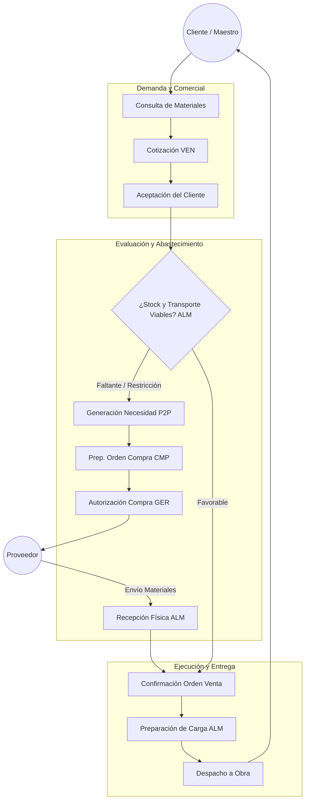

# Cadena de Suministro: Actores y Flujo de Abastecimiento

**Estado:** Documento de análisis. Este archivo mapea los actores involucrados, el flujo operativo y cuantifica las cinco variables clave de la cadena de suministro de Ferre & Inversiones MIGAL, basándose en la arquitectura del sistema (Odoo 19 Community) y los procesos O2C y P2P vigentes. Los valores cuantitativos marcados con `[SIM]` corresponden a datos sintéticos formulados para modelar el escenario operativo.

## 1. Actores y Matriz RACI de la Cadena

El flujo de la cadena de suministro en MIGAL articula las áreas comerciales, logísticas y financieras. Las responsabilidades se distribuyen de acuerdo con el modelo de autorización del sistema.

| Actor / Rol | Responsabilidad en la Cadena de Suministro |
| :--- | :--- |
| **Cliente / Maestro de Obra** | Genera la demanda a través de consultas y requerimientos de materiales (O2C). |
| **Atención y Ventas (VEN)** | Capta la demanda, consolida el requerimiento comercial y genera la solicitud interna de orden de venta. |
| **Almacén y Despacho (ALM)** | Evalúa la viabilidad logística (stock, transporte), recepciona mercadería, ejecuta el inventario y despacha. |
| **Compras y Abastecimiento (CMP)** | Consolida las necesidades de reposición (P2P), negocia y prepara las órdenes de compra para los proveedores. |
| **Gerencia (GER)** | Autoriza compras, aprueba excepciones (descuentos, créditos, ajustes de inventario) y toma decisiones de contingencia. |
| **Facturación y Cobros (FCO)** | Registra comprobantes, concilia pagos de clientes y abonos a proveedores, asegurando el flujo de caja. |
| **Admin. de Sistema (SIS)** | Garantiza la operatividad técnica del entorno y los accesos para que fluya la información. |
| **Proveedor** | Suministra los materiales de reposición, cumpliendo con los niveles de servicio y tiempos de entrega acordados. |

### Matriz RACI (Responsable, Aprobador, Consultado, Informado)

| Actividad de la Cadena | GER | VEN | ALM | CMP | FCO | SIS | Proveedor |
| :--- | :---: | :---: | :---: | :---: | :---: | :---: | :---: |
| **1. Captación de Demanda** | I | R | C | I | - | - | - |
| **2. Evaluación de Viabilidad Logística** | A | C | R | C | - | - | - |
| **3. Requerimiento de Abastecimiento** | I | I | C | R | - | - | - |
| **4. Autorización y Orden de Compra** | A | - | I | R | C | - | I |
| **5. Suministro y Recepción Física** | I | I | R | C | - | - | R |
| **6. Preparación y Despacho a Obra** | I | C | R | - | - | - | - |
| **7. Conciliación y Flujo de Pagos** | A | I | - | C | R | I | I |

## 2. Flujo de Abastecimiento (Extremo a Extremo)

El siguiente diagrama ilustra la conexión directa entre la demanda comercial y la reposición logística, integrando las fronteras entre el CRM y los procesos P2P y O2C definidos en la arquitectura.

## 3. Cuantificación de Variables Operativas

Para evaluar el impacto de las fallas y el mantenimiento en la continuidad operativa, se definen los siguientes parámetros operativos basados en el modelo de operaciones de ferretería pesada de MIGAL.

| Variable | Descripción y Unidades | Rango Operativo / Valor de Referencia |
| :--- | :--- | :--- |
| **1. Demanda** | Volumen de salida de materiales principales (agregados y cemento) requeridos por proyectos de obra. | **[SIM]** 150 a 200 toneladas semanales (aprox. 6 000 bolsas de cemento/mes + fierro y agregados). Noviembre a febrero se toma como temporada alta en el escenario. |
| **2. Inventarios** | Niveles de existencias en la tienda principal y los dos almacenes (Stock de ciclo + Stock de seguridad). | **[SIM]** Stock Actual Promedio: 60 toneladas. Stock de Seguridad Crítico: 15 toneladas (2 días de cobertura operativa). |
| **3. Capacidad** | Límite máximo de procesamiento de la infraestructura logística (toneladas despachadas por día). | Carga útil por viaje: baranda 2 500 kg, volquete 3 580 kg y eléctrico 500 kg para despachos cercanos. Las 40 t/día permanecen como escenario [SIM]. La capacidad diaria depende de los viajes, la carga, el tiempo de preparación y las rutas disponibles. |
| **4. Disponibilidad** | Porcentaje de tiempo que la flota de transporte y los equipos de izaje están operativos y listos para despachar. | Disponibilidad observada: no medida. El 95 % es una meta propuesta para activos críticos y el rango 91,2 %–94,9 % corresponde al escenario [SIM]. El mantenimiento de los camiones se alterna para conservar uno disponible. |
| **5. Nivel de Servicio** | Indicador de cumplimiento de entregas al cliente en las condiciones acordadas (OTIF - *On Time In Full*). | Meta propuesta de OTIF: **90 %**. Valor observado: no medido. Indicador de alerta: Entregas parciales por restricción de volumen o paradas de transporte no planificadas. |

## 4. Restricciones de carga y despacho

La capacidad de despacho es una restricción que puede aparecer en la carga o en el transporte, según los pedidos del día. Si falla la maquinaria, el personal suele recurrir al trabajo manual y reorganiza las cargas que requieren equipo. Si un camión está en mantenimiento, se reorganizan los despachos con el otro. El volquete también atiende pedidos generales compatibles y el vehículo eléctrico puede cubrir entregas cercanas de hasta 500 kg.

Se priorizan los pedidos según el compromiso de entrega y la compatibilidad con los vehículos disponibles. Cuando la carga o la ruta impiden atender un pedido durante el día, se coordina una nueva fecha con el cliente. Véase el [análisis de continuidad](../continuidad/continuidad_cadena.md) para las alternativas por activo y el registro del impacto en el servicio.
